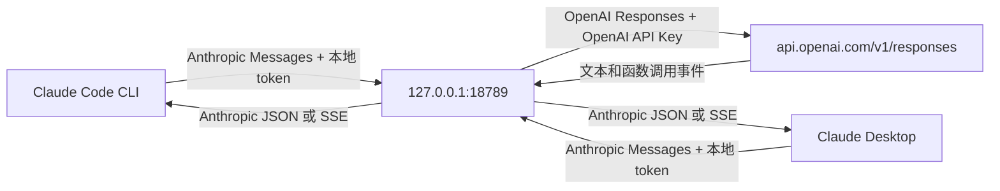

# Claude OpenAI Gateway

保留 Claude Code / Claude Desktop 的操作界面，通过本地协议转换网关使用自己的 OpenAI API Key。本仓库记录 2026-10-30 的本机配置方法与代码。

**当前正在使用的运行目录仍是 `/Users/mac/Documents/ChatGPT/个人/claude-openai`。本仓库是独立源码，不复制现有 Key，不自动迁移桌面设置。不要同时启动两份占用 18789 端口的服务。**

## 工作原理



不能只把模型名改成 GPT：Claude 发出的是 Anthropic Messages 协议，OpenAI 提供的是 Responses 协议，工具定义、工具结果和流式事件都需要转换。

Python 负责配置、密钥和进程管理，Node.js 负责 HTTP 和流式转换，因此项目不是纯 Python。还有另一层网络代理：Clash 负责访问 OpenAI 的网络连通性；本项目网关负责协议翻译，二者分工不同。

## 代码结构

| 文件 | 用途 |
|---|---|
| `manage.py` | 隐藏输入 Key，启动/停止网关，生成 CLI 配置，真实 API 验证 |
| `src/server.js` | 本机 HTTP 路由、鉴权、模型别名、非流式累积 |
| `src/responses-backend.js` | Messages → Responses，解析上游文本和函数调用事件 |
| `src/anthropic-stream.js` | Anthropic SSE 内容块与生命周期事件 |
| `config.example.json` | 不含密钥的配置模板 |
| `*.command` | macOS 双击入口 |
| `tests/` | 不需要 Key 的离线回归测试 |
| `private/` | 运行后生成的私密凭证、状态和日志；被 Git 忽略 |
| `docs/implementation.md` | 具体协议映射与代码说明 |
| `docs/local-setup.md` | 本机操作全过程、桌面设置、排障和迁移 |

源码来源和改动见 [THIRD_PARTY_NOTICES.md](THIRD_PARTY_NOTICES.md)。

## 从零配置

要求：macOS、Python 3.10+、Node.js 24+、已安装 `claude` CLI。没有第三方 Python/npm 依赖。Node 24 用于内置 fetch 和环境代理支持。

```bash
cd /Users/mac/code/python/claude-openai-gateway
cp config.example.json config.json
```

按本机环境修改 `config.json`：

```json
{
  "model": "gpt-6.1-sol",
  "reasoning": "medium",
  "https_proxy": "http://127.0.0.1:7897",
  "port": 18789
}
```

`7897` 是本次可用的 Clash 端口，其他机器需改成自己的代理。能直连时把 `https_proxy` 设为空字符串。模型和 reasoning 需要与 API 组织的实际权限、模型能力匹配。

创建领取额度的 API 组织下的项目 Key，然后运行：

```bash
./setup.command
```

终端隐藏输入 Key。脚本先验证模型列表，再测试工具调用、结果回传和流式回复，会消耗少量 API 额度。Key 不要写在命令行参数、Git 或截图里。

脚本优先检查指定运行时和 PATH，并检查常见的本机 NVM 安装。必要时可显式指定：

```bash
CLAUDE_OPENAI_NODE=/绝对路径/node \
CLAUDE_OPENAI_CLI=/绝对路径/claude \
python3 manage.py start
```

## 终端版使用

在你要操作的项目目录启动：

```bash
cd /你的项目路径
/Users/mac/code/python/claude-openai-gateway/launch.command
```

入口自动启动网关，为当前 Claude 进程传入独立的 `--settings` 和 `--model`；不会改写 `~/.claude/settings.json`。原来的 `claude` 命令仍可使用阿里云配置。

## 桌面版使用

桌面端不继承 CLI 的网关设置，需要在自己的第三方推理配置中填写：

| 字段 | 本次配置 |
|---|---|
| Inference provider | Gateway |
| Gateway base URL | `http://127.0.0.1:18789`，不加 `/v1` |
| Credential kind | Static API key |
| Gateway API key | `private/gateway-token.json` 中的本地 token，**不是 OpenAI Key** |
| Gateway auth scheme | bearer |
| Model discovery | off |
| Model ID | `claude-sonnet-4-5`，仅为桌面兼容路由别名 |
| Display name | `GPT-6.1 Sol · OpenAI API` |

完整菜单步骤见 [本机配置记录](docs/local-setup.md)。

**实际模型由网关的 `config.json` 指定。Claude 名称只是兼容路由，不表示实际使用 Claude 模型。** 桌面官方网关支持面向 Claude，这个 GPT 接法属于非官方兼容实现，后续版本可能改变校验和行为。

保存并重启后：

```bash
./launch-desktop.command
```

该入口先启动网关，再打开 Claude；没有注册系统开机自启。重启电脑后，只点 Claude 图标不会自动启动本地网关。

## 测试与管理

```bash
# 离线，不访问 API，不需要 Key；须在 Node 24+ 环境下运行
npm test

# 真实 API 验证，会消耗少量额度
python3 manage.py verify

# 只启动网关
python3 manage.py start

# 停止本目录管理的网关
python3 manage.py stop
```

本次配置实测：

- Responses API、函数调用、工具结果回传、流式文本通过。
- CLI 返回 `CLAUDE_GATEWAY_OK`。
- Claude Desktop 对话返回 `DESKTOP_GPT_OK`。
- 桌面 Code 文件读取测试未完成：当时卡在信任文件夹步骤，重启恢复。不能把对话成功当成全部工具兼容。

## 当前实现的边界

- token 计数按字符估算，不是 OpenAI 精确计费；桌面费用估算也不等于账单。
- 不完整转换缓存、thinking、原生服务端工具、工具搜索、文档输入等字段。
- 用户消息支持文本和图片；工具结果里的图片转成占位文字。
- 禁用并行工具调用，降低内容块和并发参数流的转换复杂度。
- 不保留或回传 OpenAI 加密推理内容，长任务连续性与原生客户端不同。
- 只监听本机 IPv4 回环地址，不直接支持远程机器访问。
- Key 使用权限 600 的本地文件保存，不是 Keychain 加密存储；私密目录权限 700。
- 没有生产级并发控制、完整重试、客户端取消传播或完整 SSE 规范覆盖。
- 固定发送 reasoning.effort，不保证任意 GPT 模型都接受。

## 参考资料

- [OpenAI 工具调用](https://developers.openai.com/api/docs/guides/function-calling)
- [订阅附带 API 额度](https://developers.openai.com/api/docs/guides/chatgpt-api-credits)：额度适用范围、有效期以当前规则和组织后台为准。
- [Claude 桌面连接网关](https://code.claude.com/docs/en/llm-gateway-connect#desktop-app)
- [Claude Desktop Gateway 配置](https://claude.com/docs/third-party/claude-desktop/gateway)
