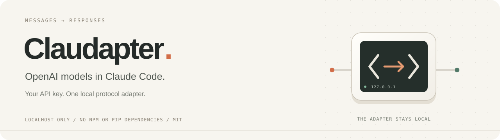

# Claudapter

Run OpenAI models from Claude Code.

Claudapter runs a small local server that translates Anthropic Messages requests into OpenAI Responses requests, then translates the replies back. It handles text, streaming, and function-call round trips without rewriting your global Claude settings.

You can keep working in Claude Code while choosing an OpenAI model for the session. Claude Desktop on macOS can also connect through its Gateway settings. Chat was tested during the initial setup; Desktop file tools still need testing.

[简体中文](README.zh-CN.md) · [Desktop setup](docs/desktop.md) · [Troubleshooting](docs/troubleshooting.md) · [Contributing](CONTRIBUTING.md)

<details>
<summary>See how requests move through Claudapter</summary>


The terminal and adapter are local; the rack represents the remote OpenAI API. Tools still execute in the Claude client.

</details>

## Getting started

You need Python 3.10+, Node.js 24+, and an OpenAI API key. For CLI use, install Claude Code and make sure `claude` is on your PATH. There are no third-party Python or npm packages to install.

Clone the repository and run the launcher:

```bash
git clone https://github.com/solielxiao/claudapter.git
cd claudapter
./claudapter
```

If you downloaded a ZIP instead, open the extracted folder and run `python3 claudapter`.

On the first run, it checks the runtimes and asks for a model, reasoning effort, optional proxy, and API key. The key is entered without echoing. It creates the configuration and tests the connection. **First-time setup makes billable API requests.** Once setup passes, later launches reuse your settings without repeating the prompts or API checks.

Claude Code opens in your current directory. To work on another project:

```bash
# Record this while you are still in the Claudapter repository.
CLAUDAPTER_DIR="$PWD"
cd /path/to/your/project
"$CLAUDAPTER_DIR/claudapter"
```

Replace the project path with your own. Your original `claude` command keeps its existing settings. Use `./claudapter setup` to configure without launching a client, or double-click `claudapter.command` on macOS. Missing runtimes are reported; no software is installed automatically.

<details>
<summary>Configuration files and a simple connection check</summary>

The guide creates `config.json`. Your model must support Responses, function calling, and the configured `reasoning.effort`; the default example is not available to every account. Leave the proxy empty for direct access, or enter your own HTTP(S) proxy URL and port.

An existing `config.json` is reused without re-prompting or overwriting. You can edit it manually and run `./claudapter restart`.

To check a text conversation with client tools disabled:

```bash
./claudapter -p "Reply with exactly CLAUDAPTER_OK." --tools "" --max-turns 1
```

This also makes a billable API request. This checks a text conversation. File tools need separate testing.

</details>

## Claude Desktop

Desktop has its own Gateway configuration. On macOS, open **Developer → Configure Third-Party Inference** and follow the [Desktop setup guide](docs/desktop.md).

One important detail: Desktop needs the local token from `private/gateway-token.json` in its gateway key field. Your OpenAI API key is stored by the local adapter and used for requests to OpenAI. After saving the Desktop configuration, start the adapter and open the app with:

```bash
./claudapter desktop
```

You can also double-click `launch-desktop.command`. Neither method registers an auto-start service, so you need to start it again after reboot.

This is an unofficial compatibility setup. Desktop currently needs a Claude-shaped route alias, which the adapter maps to your configured OpenAI model. The client may infer inaccurate context limits or capabilities from that alias. Test in a disposable directory before working with your own files.

## Current support

| Feature | Testing so far |
|---|---|
| Text, streaming, function calls and results | Offline regressions and live API checks during initial setup |
| Claude Code CLI text conversations | Manually tested during initial setup |
| macOS Claude Desktop chat | Manually tested during initial setup |
| Desktop file read/write and complete MCP workflows | Not verified |
| Windows Desktop and `.command` launchers | Not supported |

Changes since that initial setup have been checked offline. CI is configured for Ubuntu/macOS, Node 24, and Python 3.10; it does not run paid API or Desktop tests. If you change models or client versions, run your own checks too.

## Commands

Run these from the Claudapter repository:

```bash
./claudapter status        # Check the saved local instance; no OpenAI request
./claudapter restart       # Restart after configuration or source changes
./claudapter stop          # Stop an instance whose identity was verified
./claudapter verify        # Repeat the live API checks; incurs usage
npm test                  # Offline tests; no real key needed
```

After changing the model, key, proxy, runtime, or source, finish active sessions before running `restart`. The manager will not automatically restart an active instance to apply changes. `status` checks the saved instance, not whether it is using your latest configuration.

Use `./claudapter --help` for manager help, or `./claudapter -- --help` for Claude's own help. Manager messages are currently in Chinese. See [troubleshooting](docs/troubleshooting.md) for connection failures, occupied ports, and stale state after reboot.

## Data and limitations

Credentials, tokens, logs, and state are kept in the Git-ignored `private/` directory. The directory uses `700` permissions and credential files use `600`; they are not encrypted. Do not upload that directory. The server listens only on `127.0.0.1` and is intended for personal use.

Prompts and tool results are forwarded to OpenAI. The Claude client still executes tools and manages file and command permissions. Claudapter translates the protocol; the model runs on OpenAI's servers.

Caching, thinking, document input, server-side tools, and tool search are not fully mapped. Images inside tool results become placeholders. Parallel tool calls are disabled and encrypted OpenAI reasoning is not preserved, so longer tasks can behave differently from native clients. Token counts are approximate; use your OpenAI bill for actual costs.

Retry, cancellation, concurrency, and SSE handling are still basic. If a client flow fails, an issue with the client version, model, and a small redacted reproduction would help. See [CONTRIBUTING.md](CONTRIBUTING.md).

More detail: [implementation notes / 中文](docs/implementation.md) and [full setup and recovery / 中文](docs/local-setup.md).

## Acknowledgements

Translation code is adapted from [hanjun-lin/claude-gpt](https://github.com/hanjun-lin/claude-gpt), under the [MIT license](LICENSE). Attribution and the reviewed upstream commit are in [THIRD_PARTY_NOTICES.md](THIRD_PARTY_NOTICES.md).

References: [OpenAI function calling](https://developers.openai.com/api/docs/guides/function-calling) · [Claude Desktop gateway setup](https://code.claude.com/docs/en/llm-gateway-connect#desktop-app).
