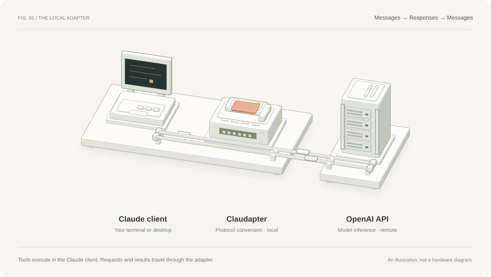

# 实现、协议转换与验证边界

这是仅供可信本机使用的实验性非官方兼容层。协议映射和离线测试不代表完整 Claude API、CLI 或 Desktop 兼容；真实桌面文件读写与完整工具流程尚未验证。



图里的设备是协议转换的示意：左侧是客户端，中间是本地 Claudapter，右侧代表远端 API，不表示模型运行在本机。

## 新手入口

`claudapter` 是 Python 入口，负责把简单命令交给管理器。首次启动缺少配置或凭证时，`connect()` 先运行 `onboard()`：检查运行时，交互生成配置，隐藏输入 Key，再测试 API；后续启动跳过这些步骤。`./claudapter setup` 只做配置，`./claudapter desktop` 配置本地服务后打开 macOS 应用。桌面 Gateway 配置不自动修改。

配置字段先由 `validate_config()` 校验，通过后才保存。不在交互终端时拒绝首次输入 Key。`setup-pending.json` 用来记录尚未通过的首次 API 检查，失败后下次仍会重试；成功才删除。已有的管理命令、私密文件格式和服务身份不改变。

## 1. 运行时、配置与凭证

需要 Python **3.10+**、Node.js **24+**。`manage.py` 查找并校验 Node 版本，Node 网关使用内置 HTTP、`fetch` 和环境代理支持。没有第三方 Python/npm 依赖，无需安装步骤或锁文件；CI 固定 Node 24。

`manage.py setup` 使用 `getpass` 隐藏读取 OpenAI API Key，不把 Key 放在命令行参数中。Key 保存在 `private/credentials.json`，本地 token 保存在 `private/gateway-token.json`；私密目录权限为 `700`，私密 JSON 文件为 `600`。这些是本地文件权限保护，不是 Keychain 或加密存储，不能抵御同一用户下的恶意进程。

| 凭证 | 使用方 | 发送目标 |
|---|---|---|
| OpenAI API Key | 管理脚本与 Node 网关 | `api.openai.com` |
| 本地 gateway token | Claude CLI / Desktop、管理器健康校验 | `127.0.0.1` 上的网关 |

管理器通过子进程环境把 OpenAI Key 交给 Node；CLI 子进程会移除继承的 `OPENAI_API_KEY`。网关接受本地 Bearer 或 `x-api-key` 认证，不把本地 token 当作 OpenAI Key。

本地 token 重启复用，默认端口为 `18789`，便于桌面保存 URL 和凭证。更换运行目录、token 或端口后，桌面配置不会自动更新。

`config.json` 指定实际默认模型、reasoning、可选网络代理和端口。**示例配置中的 `gpt-6.1-sol` 不保证账号权限；使用前检查，必要时改成实际可用、支持 Responses、函数调用和 `reasoning.effort` 的模型。** reasoning 值也须由模型支持。代理不是必需条件，直连时使用空字符串；配置代理只解决网络连通性，不参与协议翻译。

## 2. 进程身份与显式重启

管理状态不仅记录 PID、URL 和本地 token，还记录实例身份与配置指纹。管理器使用带本地 token 的 `/health` 校验响应中的 PID 和实例标识，避免仅凭端口、模型名或保存的 PID 判断进程归属。

配置指纹用于识别实际运行参数和相关实现的变化，包括 API Key、模型、reasoning、代理以及相关源码。它用于判断是否可复用现有实例，不是凭证加密或对抗恶意本地进程的远程证明。Key 不应以明文出现在健康响应中。

生命周期规则：

1. `start` 只复用身份和当前配置均匹配的实例。
2. 身份匹配但配置发生变化时，`start` 拒绝复用并提示运行 `restart`，**不会静默停止或重启现有会话**。
3. 显式 `restart` 安全停止已验证归属的实例，确认停止后按当前配置启动；停止旧实例时不能因其配置较旧就失去身份校验。
4. `stop` 拒绝对无法验证的旧版、过期或不匹配身份盲目发送信号，也不按监听端口任意杀进程。
5. 无法验证时由用户先人工确认并处理旧实例，确认退出后再清理过期状态。源码没有热重载，更新后也需要显式重启。

停止后会回收自己创建的已退出子进程；对仍等待原父进程回收的僵尸进程，也会确认其已退出，避免把 `kill(pid, 0)` 的成功误判为服务仍运行。这个检查只发生在实例身份验证并发送停止信号之后，不扩大可停止的进程范围。

流式 smoke 请求显式禁用系统代理，确保本地 token 不因环境中的 HTTP_PROXY 等变量被发往外部代理。

这些检查降低误复用和误停进程风险，不把本机 HTTP token 变成安全沙箱。不要把网关部署成多用户或公网服务，也不要绕过身份拒绝提示。

## 3. 本机 HTTP 路由

服务仅绑定 IPv4 回环地址 `127.0.0.1`：

- `GET /health`：要求本地 token，返回健康状态、配置模型和进程身份，不调用上游。
- `POST /v1/messages`：鉴权后转换为官方 Responses 请求。
- `POST /v1/messages/count_tokens`：鉴权后在本地按字符长度估算 token，不是精确 tokenizer 或计费接口。

没有 `GET /v1/models`，因此桌面应关闭模型自动发现并显式填写模型路由。客户端 base URL 不加 `/v1`。

## 4. 请求映射

| Anthropic Messages | OpenAI Responses |
|---|---|
| 顶层 `system` 文本 | `instructions` |
| 用户文本 | `input` 中 `message` / `input_text` |
| assistant 文本 | `message` / `output_text` |
| 用户图片 | `input_image`，保留 URL 或 data URL |
| `tools[].input_schema` | 函数工具 `parameters` |
| assistant `tool_use` | `function_call`，保留调用 ID |
| 用户 `tool_result` | `function_call_output`，对应 `call_id` |
| `tool_choice: any` | `required` |
| `tool_choice: tool` | 指定名称的 `function` |
| `max_tokens` | `max_output_tokens`，最低 16 |

例如：

```json
{"type":"tool_use","id":"call_123","name":"Read","input":{"file_path":"check.txt"}}
```

转换为：

```json
{"type":"function_call","call_id":"call_123","name":"Read","arguments":"{\"file_path\":\"check.txt\"}"}
```

工具实际由 Claude 客户端执行，而不是网关执行；客户端返回 `tool_result` 后，网关构造对应 `function_call_output`。调用 ID 的关联是多轮工具循环成立的关键。客户端仍需工作区信任和系统权限，不应默认授予全盘访问或绕过权限提示。

assistant 内容按原顺序转换：相邻文本可合并，工具调用会刷新文本缓冲，避免把工具调用前后的说明文字挪到一起。工具结果中的图片仅转换为占位文字，不是完整多模态工具回传支持。

工具设置 `strict: false`。schema 清理仅沿 schema 关键字上下文移除 `$schema` 和 Anthropic `cache_control`，不删除恰好同名的属性、定义名称，也不改写 `default`、`enum`、`examples` 等字面数据。这是有限兼容策略，不是完整 JSON Schema 转换器。

## 5. 输出、流式事件与错误

上游固定为 `https://api.openai.com/v1/responses`，使用 OpenAI API Key，没有 ChatGPT/Codex 订阅登录接口。请求固定使用：

- `stream: true`
- `store: false`
- `parallel_tool_calls: false`
- `reasoning: { effort: ... }`

非流式客户端也读取上游流，再由 Collector 累积为普通 Anthropic JSON。流式客户端使用 `AnthropicStreamWriter` 产生 `message_start`、内容块 start/delta/stop、`message_delta` 和 `message_stop`。

| OpenAI 事件 | Anthropic 一侧的处理 |
|---|---|
| `response.output_text.delta` | 文本块 delta |
| `response.refusal.delta` | 可见文本 delta，不静默丢弃拒绝内容 |
| `response.output_item.added` 中的 `function_call` | 打开 `tool_use` 块，记录 item ID / call ID |
| `response.function_call_arguments.delta` | 工具参数 JSON 片段 |
| `response.completed` | 更新 usage 并完成；若状态为 incomplete，按原因处理 |
| `response.incomplete` 且原因为 `max_output_tokens` | 映射为 `max_tokens` |
| 其他或未知 incomplete 原因 | 报错，不伪装为输出长度不足 |
| `response.failed` / `error` | 报错 |

流已开始后发生错误时发送 SSE `error`，而不是正常的成功结尾。上游没有完成事件就断开时抛错。拒绝的 done 事件不重复追加已经输出的 delta。

输出下限 `Math.max(16, body.max_tokens)` 可避免客户端用 `max_tokens: 1` 探测模型时产生已知的过小输出参数问题，但不是对任意模型所有参数约束的保证。

当前没有完整重试、生产级并发控制、客户端取消传播或完整 SSE 规范覆盖；thinking、缓存、原生服务端工具、工具搜索、文档输入等不完整转换。不保存或回传 OpenAI 加密推理内容，长任务连续性与原生客户端不同。

## 6. 模型路由与桌面限制

`gpt`、`gpt-mini`、`gpt-small` 是本地快捷别名，映射到配置默认模型或 small 模型配置。以 `gpt`、`o` 加数字、`codex` 开头的请求名会作为上游模型路由，其他名字映射到默认模型。实现没有完整 allowlist，仅适合可信本机。

桌面可以尝试显式配置 `claude-sonnet-4-5` 作为兼容路由别名；是否接受取决于客户端版本。这个名字不表示网关连接 Anthropic，也不保证客户端推导的上下文长度、输出上限和工具能力与上游一致。实际默认推理由 `config.json` 指定的模型完成。

桌面官方网关功能面向 Claude，此转接不是官方 OpenAI 集成。CLI 设置不会自动配置桌面；桌面对话成功也不能证明文件操作、MCP 或所有 Code 功能兼容。真实桌面文件读取、写入和完整工具流程尚未验证。

## 7. 验证方式与覆盖含义

### 离线测试

在仓库根目录执行 `npm test`。需要 Node 24+ 和 Python 3.10+，不安装依赖、不需要真实 Key、不调用真实 API。测试通过 mock fetch 或受控本机测试实例验证行为，不应接触现有用户网关。

覆盖包括官方 endpoint、schema 上下文、assistant 文本/工具顺序、调用 ID、工具结果、输出下限、refusal、incomplete 原因、流中断和 SSE 分段校验；管理测试验证实例身份、配置变化和安全停止的约束。测试是回归保护，不是完整协议符合性证明。

Python smoke 校验解析 SSE 的 `data` JSON，拼接 `delta.text` 后检查结果，同时要求正常结束且无 error。直接在原始 SSE 查找完整单词会把合法的分段输出误判为失败，回归测试保留该用例。

GitHub Actions 的 `.github/workflows/test.yml` 在 `ubuntu-latest` 和 `macos-latest` 上使用 Node 24、Python 3.10 执行 `npm test`。无第三方依赖和 lockfile，不执行 `npm install` 或 `npm ci`，不提供 API Secret，不运行真实 API 验证。

### 真实 API 验证

`manage.py setup` / `verify` 使用保存的真实 Key，测试函数调用、工具结果回传与流式文字，产生实际 API 用量。首次设置还检查模型列表；列表可见不保证 Responses/reasoning 和工具能力都可用。

真实验证不能代替桌面 UI、文件权限或完整 MCP 工作流测试。发布前的离线测试不应被描述成当前模型、账号或桌面版本的真实兼容认证。
